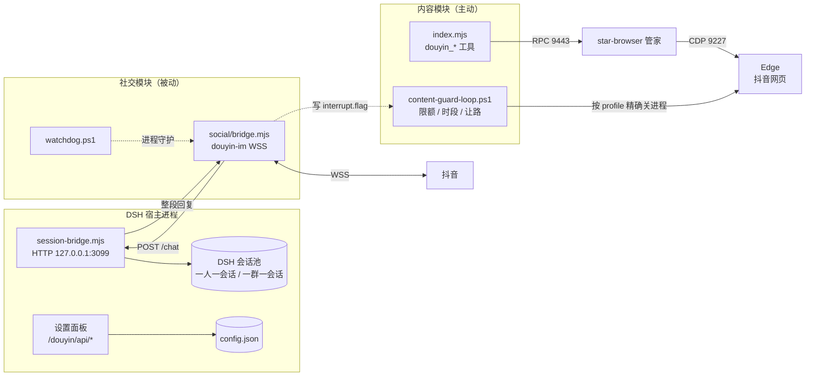
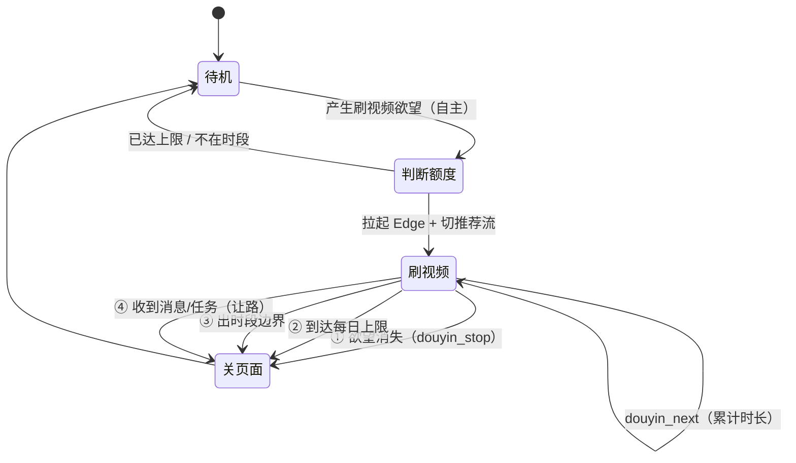
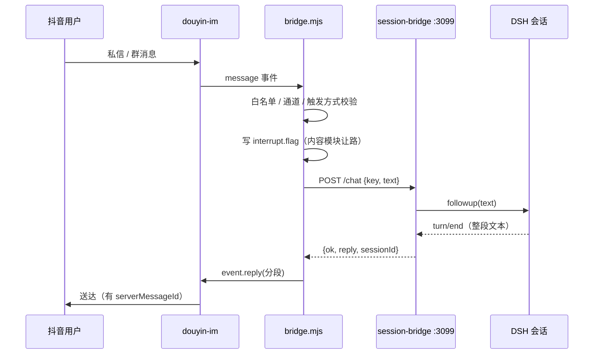

# 架构

## 一句话

**内容模块**用浏览器管家主动刷视频，**社交模块**用 douyin-im 纯 Node 被动收发消息。
两者共用一份 `config.json`，但**运行时不互相依赖**。

## 总览



## 模块边界（三条隔离）

社交模块不碰浏览器，靠三层保证：

| 层 | 做法 |
|---|---|
| **入口隔离** | 内容模块的入口是 `douyin_*` 工具（走 9443 RPC）；社交模块的入口是 douyin-im 的 WSS，`features.chat` 关掉后浏览器侧的私信工具根本调不动 |
| **依赖隔离** | `social/bridge.mjs` 只 import `node:fs/path/net` 和 `douyin-im`，不碰 9443 / 9227 / 任何 CDP |
| **可观测隔离** | 社交链路跑全程，`msedge` 进程 PID 集合不变 |

另有一条提示词约束：`workspace/AGENTS.md` 禁止会话调用任何工具，防止模型自己去打开浏览器。

## 内容模块：一次刷视频的生命周期



四个关闭源都走 `content-guard-loop.ps1`，日志里 `reason=` 分别是 `done` / `cap` / `window` / `interrupt`。

## 社交模块：一条消息的旅程



### 会话为什么不会每次新建

`session-bridge` 建会话的顺序是 **先 resume 再 create**：

```js
try { handle = await ctx.agents.resume({ resumeSessionId: sessionId, ... }) }
catch { handle = await ctx.agents.create({ sessionId, ... }) }
```

`key` → `sessionId` 的映射落盘在 `social/sessions.json`，所以桥重启、宿主重启都接回同一条会话。

### 为什么不会出现"打字机碎片"

桥只监听 `assistant/message`（一条完成的消息）和 `turn/end`，
**不监听 `assistant/chunk`**，所以吐给抖音的永远是整轮跑完之后的一段完整文本。

## 数据文件

| 文件 | 谁写 | 作用 |
|---|---|---|
| `config.json` | 设置面板 | 全部配置；保存即时生效 |
| `state.json` | 内容模块 | 今日计数（浏览秒数 / 赞 / 藏 / 评 / 转发 / 回复），0 点重置 |
| `browse-log.jsonl` | `douyin_next` | 每条视频一行（文案 / 点赞数 / 时间），日报的素材 |
| `reports/douyin-diary-*.txt` | `daily-report.mjs` | 日记体日报 |
| `social/channels.json` | `bridge.mjs` | 群 / 好友清单（白名单勾选的数据源） |
| `social/sessions.json` | `session-bridge.mjs` | key → sessionId 映射 |
| `social/outbox.json` | `douyin_share` 等 | 出站投递（主动发卡片/文字） |
| `social/bridge.log` | `bridge.mjs` | 消息收发日志（含 serverMessageId） |
| `social/content-guard.log` | 守卫 | `CLOSED reason=...` 记录 |
| `data/` | douyin-im | 登录态（Cookie / 设备身份），**不要提交** |

## 几个关键实现点

- **表情**：抖音自带表情是"文本式内联渲染"，发 `[呲牙]` 这几个字对方就渲染成图；收藏表情是图片式，走 `segment.sticker()`。
- **视频卡片**：`segment.share({ itemId })`，`itemId` 就是 aweme_id。
- **取 aweme_id**：从接口日志里带 `group_id=` 的请求抠出来，再用页面 DOM 反查校验（命中次数 > 0 才算数）。
- **评论**：只有顶层评论；真 @ 和楼中楼未实现。

## 已知限制

1. 抖音网页端发评论可能弹短信验证（平台风控），需在浏览器手动过一次验证
2. 评论里真 @ 某人做不到（要操作下拉选人）
3. `social/*.ps1`（守卫 / 看门狗 / 定时）是 Windows PowerShell；非 Windows 请用 cron / systemd 替代，或只跑社交模块
4. `douyin-im` 是第三方库，其登录链与部分接口尚未经大规模真实账号验收